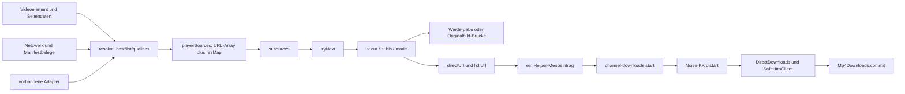

# Kadri / Android Helper – verbindliche technische Übergabe an Claude Code

Stand: 03.11.2026. Auftrag: bestehendes C3 zunächst stabilisieren, gemeinsame Medienquellen einführen und direkte MP4-Alternativen integrieren; HLS erst danach. Diese Übergabe ändert ausschließlich Dokumentation. **Produktion bleibt UNAPPROVED.**

## 1. Verifizierter Stand und Beweislage

| Repository | Branch / PR | Verifizierter Kopf vor diesem Dokumentationscommit | Status |
|---|---|---|---|
| https://github.com/Owndot/Kadri | `feature/c3-helper-mp4`, #11 | `f992f32a80620f86e73acfbf66288a9badaaa548` | offen, Draft, nicht gemergt |
| https://github.com/Owndot/video-assistent-helper | `feature/c3-browser-downloads`, #27 | `12022d2ee08720f855a4e7c0fd250f68fed2dd31` | offen, Draft, nicht gemergt |

Die Köpfe wurden für diese Übergabe erneut über GitHub geprüft; seit der vorigen Architekturprüfung sind sie unverändert. Der Dokumentationscommit, der diese Datei hinzufügt, ist ein Nachfolger des genannten Kadri-Kopfs. Claude muss lediglich dessen Diff und eventuelle spätere Änderungen prüfen, nicht die gesamte bereits dokumentierte Analyse wiederholen. Vor Änderungen Arbeitsbaum, Branch und Remote-Kopf kontrollieren; nichts zurücksetzen oder fremde Änderungen verwerfen.

Vergleiche: Kadri `7621884bec349cb4501dbfa58c418a6676e372a5` → `f992f32…` ändert nur `.github/workflows/c3-test-extension.yml`. Helper `ca605408924644eeba6c29b4037dd90a324bb078` → `12022d2…` ändert nur `.github/workflows/c3-private-test-pair.yml`. Der ausgelieferte Helper-Anwendungscode ist damit weiter `ca60540`; keine neue Downloadengine wurde zwischenzeitlich implementiert. PR-Beschreibungen nennen teilweise ältere Testzahlen und den inzwischen ersetzten Pool-Fix; aktueller Code und Logs sind maßgeblich.

**Implementiert:** direkte MP4 über Noise-KK; URL-freies Browserjournal mit Idempotenz und dauerhaftem Abbruchwunsch; gehärteter Helper-Netzwerkweg; sichere Veröffentlichung; kompakte Popup-Ansicht; letzte Korrektur zur Freigabe tatsächlich geladener Playerquellen. **Nicht implementiert:** gemeinsamer Quellenbestand mit unabhängiger Downloadauswahl, C3-HLS-Download, C3-DASH-Download, dauerhafte Segmentwiederaufnahme und aktualisierbare Geräte-Testsignierung.

**Nachgewiesene vorhandene Ergebnisse:**

- Kadri [CI 41547258703](https://github.com/Owndot/Kadri/actions/runs/41547258703), Anwendung `7621884`: alle fünf Jobs erfolgreich; Kanal-Unit 36/36, Download-Unit 85/85, Kanal-Integration 74/74, Download-Integration 38/38, Kanal-Browser 34/34, Fail-closed 4/4; Player/Helper 18/18, Menü 7/7, MP4-Browser 63/63; Kanalmutationen 45, Popupmutationen 9, Quellenmutationen 6 erkannt.
- Kadri [CI 41547332622](https://github.com/Owndot/Kadri/actions/runs/41547332622), Kopf `f992f32`: vier Jobs erfolgreich, `helper-channel` fehlerhaft. Im `test_mp4.py` scheitern vier Assertions desselben Login-Szenarios. Daher aktuelle Basis **nicht uneingeschränkt grün**. Keine erfolgreiche Wiederholung als Ursachenbeweis ausgeben.
- [Paketlauf 41547325899](https://github.com/Owndot/Kadri/actions/runs/41547325899) erfolgreich; er prüft und verpackt ausdrücklich `7621884`, nicht beliebigen aktuellen Code. Paket-Erfolg überstimmt keinen roten Quellcode-Lauf.
- Helper [41284921118](https://github.com/Owndot/video-assistent-helper/actions/runs/41284921118): Kern/JVM/Mutationen sowie Emulatoren API 26 und 34 erfolgreich. [41284921088](https://github.com/Owndot/video-assistent-helper/actions/runs/41284921088) und ursprünglicher Paketlauf [41284918162](https://github.com/Owndot/video-assistent-helper/actions/runs/41284918162) ebenfalls erfolgreich. Das sind vorhandene CI-Ergebnisse, keine neu durchgeführten Emulatorprüfungen dieser Übergabe.
- Auf frisch vom aktuellen Stand gelesenen Dateien wurden Quellenregressionen einschließlich 6 Mutationen und Popupregressionen einschließlich 9 Mutationen lokal erfolgreich ausgeführt. Für diese Übergabe zusätzlich die unten beschriebene `hdlProbe`-Race mit tatsächlichem Quellcode unabhängig reproduziert.
- Nutzerbefund vom Samsung: zwei Mozilla-MP4s wurden gespeichert und waren abspielbar. Die konkreten weiteren Website-URLs wurden nicht erfolgreich als vollständige sitzungslose Helper-Downloads verifiziert.

## 2. Tatsächliche Aufrufketten und Architekturbruch

Alle Kadri-Verweise beziehen sich auf `f992f32…`, Helper-Verweise auf `12022d2…`; Zeilennummern können nach der Implementierung wandern. Funktionsnamen sind die dauerhaften Suchanker.

Die Java-Verweise liegen unter `app/src/main/java/de/evp/helfer/`: `ChannelServer.java`, `ControlCommands.java`, `HelferService.java`, `Mp4Downloads.java`, `dl/DirectDownloads.java`, `dl/DownloadStore.java`, `net/SafeHttpClient.java`; der getrennte Legacy-Pfad liegt in `HlsCore.java` und `Downloads.java`.

| Bereich | Datei, Funktion / Datenstruktur | Funktion heute |
|---|---|---|
| Beobachtung in der Seite | `chrome/page.js`: `kindOf`, `ctKind`, `send`, Fetch-/XHR-Hooks, `kadri-net` | Begrenzte Manifest-/API-Beobachtungen aus MAIN-world; keine vertrauenswürdige Autorisierung. |
| Netzwerkzuordnung | `src/040-quellen-netzwerk.js`: `sources`, `plInfo`, `assetHits`, `addSource`, `notePlaylist`, `noteSegment`, `playingStream`, `recent`, `checkNav` | Quellen, Dauer-/Segmentbelege, begrenzte Manifestbeziehungen; mehrere Heuristiken und getrennte Caches. |
| Seitendaten | `src/050-quellen-seitendaten.js`; `src/060-quellen-zuordnung.js`: `classify`, `mediaNear`, `localNear`, `resolve` (ab Zeile 376) | Liefert `{best,alt,how,ids,list,qualities,…}`; nicht jedes Feld ist bei jedem Pfad vorhanden. |
| Bestehender MP4-Adapter | `src/070-extern-ytdlnis.js`: `phMp4`, `phCache`, `phHref` | Browserseitige Metadatenabfrage; Liste `{u,res}`. Cache wird bei Seitenwechsel zurückgesetzt, nicht anhand allgemeiner Token-Gültigkeit. Browserinterne Credentials sind kein Recht, sie zum Helper zu exportieren. |
| Öffnen | `src/110-knopf-am-video.js`: Klickpfad und `go`; `src/130-player-aufbau.js`: `openBrowserPlayer` | Eigener Player wird mit Originalvideo und Quellenliste angelegt; externe Intent-Wege sind davon verschieden. |
| Playerliste | `src/120-player-stil.js:300`, `playerSources(v,resMap)` | Reduziert `resolve`-Ergebnis und ggf. `phCache` auf URL-Array; Höhe verbleibt getrennt in `resMap`. Herkunft, Zuordnung und Rolle sind kein einheitlich transportierter Vertrag. |
| Playerzustand | `src/130-player-aufbau.js:8`: `st.sources`, `st.srcRes`, `st.idx`, `st.cur`, `st.mode`, `st.hls` | Sammlung von Kandidaten plus genau eine aktuelle Quelle. |
| Wiedergabe | `src/170-player-laden.js:116`: `tryNext`, `startBridge`, Capture-Fallback | Setzt `st.cur` vor Laden; kann HLS abspielen und vorübergehend Originalvideo spiegeln. |
| Qualitätsmenü | `src/190-player-menues.js:51`: `qualityItems`, `switchSource` | HLS-Level oder direkte Dateien mit `srcRes`; wählt eine Wiedergabequelle, keinen eigenständigen Downloadplan. |
| C3-Eignung | `src/180-player-bedienung.js:130–155`: `directUrl`, `hdlUrl` | Verwendet nur `st.cur`; verlangt `own`, kein `st.hls`, kein M3U8/MPD; zusätzlich `readyState>=2`, passende `currentSrc`, kein Fehler/srcObject. |
| C3-Menü/Start | dieselbe Datei: `hdlProbe` 188, `hdlStart` 205, `dlMenu` 249 | Ein Helper-Angebot für diese eine URL, nicht für sämtliche passenden MP4-Alternativen. |
| Erweiterung → Auftrag | `src/080-helper-app.js`, `chrome/prelude.js:33` (`KADRI_DOWNLOAD`), `channel/channel-service.js:61` (`DL`, `dlValid`) | Strenge Runtime-Nachrichten; `start/find` aus eigenen Tab-Inhaltsskripten, Verwaltung nicht aus Webseiten. |
| Dauerhafter Auftrag | `channel/channel-downloads.js`: `createDownloads`, `start`, `status`, `cancel`, `capabilities` | Gesalzener URL-Hash, Kennung vor Start, URL nur flüchtig, Statusabgleich, `cancelling` bleibt bis Bestätigung bestehen. |
| Kanal | `channel/channel-session.js`: `downloadMessage`, `download`; Transport/Store/WASM | Festes Befehlsformat und verschlüsselte Kommunikation. Keine Playlist-/Medienübertragung. |
| Helper-Einstieg | `ChannelServer`, `ControlCommands.handle`, `HelferService.startChannel` | Bindet `mp4.engine` als `DownloadControl` an `dlstart/dlstatus/dlcancel`. |
| Transfer | `dl/DirectDownloads.java`: `start`, `run`, `checkResume`, `loadJournal` | HTTP-Status, Länge, Typ, Signatur, Speicher, ETag/Range; höchstens zwei Downloads. |
| Veröffentlichung | `Mp4Downloads.java`, `dl/DownloadStore.java` | Journal-/Besitzprüfung, MediaStore-Pending oder exklusive Veröffentlichung auf API 26–28. |



**Präziser Verlust:** `playerSources` reduziert reichere Erkennungsergebnisse auf URLs und Höhen. Die Alternativen verschwinden nicht sämtlich aus dem Speicher: sie können in `st.sources` vorhanden sein. Der Downloadpfad **ignoriert** sie, indem `hdlUrl()` ausschließlich die aktuelle Playerquelle prüft. Spielt diese HLS ab, wird sie ausgeschlossen; eine andere MP4 aus derselben Liste wird nicht unabhängig bewertet. Deshalb ist der nächste Schritt kein Lockern des Ladezustandsfilters oder ein neues Site-`if`, sondern ein separater Downloadselektor über gemeinsam erhaltene Quelleninformationen.

**Frames:** `chrome/manifest.json` lädt `page.js` und `sub.js` mit `all_frames:true`. `sub.js.want()` fordert das eigentliche Inhaltsskript an, sobald ein Video im iframe auftaucht. `background.js:317` injiziert in `sender.tab.id/sender.frameId`. `src/030-eingebettete-fenster.js` koordiniert die Oberfläche mit Quellfenster-/Schlüsselprüfungen. Der Hauptframe muss das fremde Video nicht im DOM lesen können. Kinogos leere Hauptframe-Diagnose widerspricht einem funktionierenden cinemar-Player deshalb nicht. Bestehende Berechtigungen reichen für zugängliche Frames; opaque/sandboxed oder vom Browser gesperrte Frames nicht umgehen.

## 3. P0: Fehlerbefunde und reproduzierbarer Ansatz

### 3.1 Vier Login-Assertions: bestätigte Beobachtung, Ursache offen

Run `41547332622`, Job `125626004974`; Logartefakt `13190635435`, SHA-256 `c79b0e990d3b11d973028e892f7e3259fcee8120f4c0a42bb650c22b6445819e`. Artefakt läuft nach GitHub-Angabe am 09.11.2026 ab; relevante Befunde deshalb hier dauerhaft festgehalten.

`test_mp4.py:245–252`: `player(login fixture)` → `wait_item(...)` → `dl_menu()` → `pick(ITEM)` → vier Prüfungen. Vollständiges Log: Toastliste `[]`; genau zwei protokollierte **Browser**-Abrufe auf `/videos/login.mp4`, beide mit Test-Sitzungscookie; **kein Helper-Abruf**. Danach bestehen die 404/410- und Popup-Prüfungen. Die Behauptung „Helper hat Cookies übertragen“ wird durch diesen Fehler nicht belegt. Die Assertion „kein Ausweichweg“ scheitert bereits, wenn statt genau einem Helper-Abruf null vorhanden sind.

Testlücke: `wait_item` liefert nach Fristablauf die letzte Liste zurück, ohne selbst zu scheitern. `pick` in `tests/common.py:195` liefert `false`, wenn der Eintrag fehlt; der Login-Test prüft diesen Rückgabewert nicht. `open_player` prüft `currentTime`, fängt das Warten auf das Ende der Brücke jedoch ab. Dadurch kann eine nicht vorhandene Startvoraussetzung vier nachgelagerte Fehler erzeugen. Das ist am Code gesichert; ob genau das hier geschah, muss instrumentiert reproduziert werden.

P0-Instrumentierung: bei fehlendem Eintrag einmalig redigierte Zustände `readyState`, `paused`, `ended`, `error.code`, Vorhandensein von `srcObject`, Quellenübereinstimmung als Boolean, Brückenstatus, Menülabels und Capability-Antwort/-Generation erfassen. Keine echten URLs, Cookies oder Serverantworttexte loggen. Vor dem Klick Eintrag und `pick(...) == true` ausdrücklich prüfen. Keine Assertions entfernen, Sleeps pauschal erhöhen oder Anmeldungsfixture öffentlich machen.

### 3.2 Unabhängig nachgewiesene hdlProbe-Race

In `src/180-player-bedienung.js:188–200` wird `st.hdl.probed = u` gesetzt, bevor `helperDl('caps')` beantwortet ist. Wenn beim Eintreffen `hdlUrl() !== u` ist (etwa kurz `readyState<2`), wird zurückgekehrt. `probed` bleibt jedoch auf dieser URL; bei später wieder geeigneter Quelle verhindert die frühe Gleichheitsprüfung jeden neuen Probeversuch. `ok` kann dauerhaft `false` bleiben. Derselbe Grundgedanke gilt für vorübergehende Fehler; getrennt testen, nicht Ursachen gleichsetzen.

Die folgende lesende Gegenprobe wurde mit dem tatsächlichen Quelltext ausgeführt und reproduziert den Zustand. Sie ist **kein Beweis**, dass diese Race den CI-Lauf oder den Samsung-404 verursacht hat:

```bash
node <<'JS'
const fs=require('fs'),vm=require('vm'),assert=require('assert/strict');
const s=fs.readFileSync('src/180-player-bedienung.js','utf8');
const body=s.slice(s.indexOf('    function hdlProbe()'),s.indexOf('    // Start nach Tipp.'));
let ready=true,resolveCaps,calls=0;
const st={hdl:{probed:'',ok:false},refreshDl(){}};
const ctx={st,vp:st,hdlUrl:()=>ready?'https://media.example/clip.mp4':'',
  KADRI_DOWNLOAD:()=>{},helperDl:()=>{calls++;return new Promise(r=>resolveCaps=r);},
  hdlSet(){},hdlActive:()=>false};
vm.runInNewContext(body,ctx);
(async()=>{
  ctx.hdlProbe(); ready=false; resolveCaps({ok:true,value:{supported:true}});
  await Promise.resolve(); ready=true; ctx.hdlProbe();
  assert.equal(calls,1); assert.equal(st.hdl.ok,false);
  assert.equal(st.hdl.probed,'https://media.example/clip.mp4');
  console.log('BUG REPRODUCED: no re-probe after temporary ineligibility');
})().catch(e=>{console.error(e);process.exitCode=1;});
JS
```

Claude soll zuerst einen echten Regressionstest formulieren, der das gewünschte erneute Prüfen fordert und am alten Code scheitert. Korrektur: `pending`, erfolgreich geprüfter Zustand und Generation auseinanderhalten; veraltete Antworten ignorieren, ohne gültige Wiederprüfung zu sperren. Kein rekursiver Probe-Sturm, keine generellen Netzwerk-Retries und kein Medienabruf durch bloße Capability-Prüfung. Replaced-player, Quellenwechsel A→B→A, verspätete Antwort und Ablehnung ebenfalls testen.

### 3.3 Popup und „File not found“

`chrome/popup.js:61` ff. implementiert bereits: aktive Zustände einschließlich `cancelling`, beim Öffnen keine alten `done`-Einträge, beobachteter Erfolg vier Sekunden, Fehler/interrupted einzeln schließbar. `kadri-download-dismissed-v1` ist ein eigener UI-Schlüssel; `kadri-dl-jobs` bleibt unverändert. Die Tests in `tests/popup_downloads_check.js` und `tests/test_mp4.py` schützen das. Nicht neu schreiben oder mit einem historischen Quellenkatalog ersetzen.

`DirectDownloads.run()` meldet bei initialem Nicht-200 `http_<Status>`. `channel/channel-downloads.js` bildet `http_404` und `http_410` auf „Datei nicht gefunden“ ab. Die lokale Fixture bestätigt diese tatsächlichen HTTP-Fehler und das getrennte Ausblenden ohne Journaländerung. Der frühere Screenshot lag nicht vor; dessen zwei ursprüngliche Einträge sind deshalb nicht nachträglich sicher diagnostiziert. Der vom Nutzer ausdrücklich gemeldete `http_404` ist eine Serverantwort, keine Aussage über eine nachträglich verschwundene lokale Datei. Eine passende Benutzerformulierung darf HTTP-Ursache erklären, ohne URL/Token zu zeigen.

### 3.4 Sonstige C3-Grenzen, die nicht verloren gehen dürfen

- MP4-Fortsetzung innerhalb eines laufenden Jobs: nur starker ETag, If-Range, identische starke Antwortkennung, exakte 206-/Content-Range-/Längenprüfung, höchstens drei Fortsetzungen. Fehlende Content-Length bleibt `no_length`; keine stillschweigende Lockerung.
- Prozessneustart des Helpers: fertig veröffentlichte Datei wird als `done` wiedererkannt; Unfertiges wird `interrupted` und bereinigt. Das ist keine persistente MP4-Byte- oder HLS-Segmentfortsetzung.
- `unknown` ist keine Abbruchbestätigung. Browser-Abbruchabsicht bleibt dauerhaft; Wiederanmeldung/erneuter Start darf sie nicht überholen.
- Android 8–9: erfolgreiche Veröffentlichung bleibt Erfolg, auch wenn anschließend Besitzmarkierung nicht löschbar ist. Wiederherstellung darf keine fremden oder bereits veröffentlichten Dateien entfernen.
- Der Pool-Fix ist heute `DirectDownloads` → `http.withoutConnectionReuse()`; nicht bloß einmaliges `evictAll` vor dem Job. Nicht für HLS voreilig zurückdrehen.
- Dokumentierte NAT64-Restgrenzen auf älteren Android-Versionen und fehlende echte IPv6-only/DNS64-Geräteabdeckung bleiben offen (`NETWORK-SECURITY-C1.md`, `DOWNLOADS-C2.md`). Ein Emulatorerfolg beweist keine vollständige Netztopologieabdeckung.
- Eine bösartige Quelle kann denselben starken ETag für andere Bytes liefern; keine Behauptung kryptografischer Server-Inhaltsauthentizität. Vorliegende Seitendiagnosen beweisen weder Cookie-freie Erreichbarkeit noch Vollständigkeit einer MP4.

## 4. Verbindliches Zielmodell der gemeinsamen Quellenpipeline

Die folgenden Typen sind Spezifikation; das Projekt bleibt JavaScript, kein TypeScript-Buildsystem einführen. JSDoc oder gleichwertige Laufzeitvalidatoren verwenden. Neue Modulnamen sind Vorschläge, bestehende Bündelung über `tools/build.js` erhalten.

```ts
type Knowledge<T> = { status:'unknown' } | {
  status:'claimed'|'observed'|'verified'; value:T; evidenceIds:string[]
};
type MediaContext = {
  tabId:number; frameId:number; documentKey:string;
  playerId:string; mediaEpoch:number
};
type MediaSource = {
  sourceId:string; context:MediaContext;
  kind:'mp4'|'hls'|'dash'|'unsupported'|'unknown';
  role:'standalone'|'master'|'media-playlist'|'segment'|'init'|'track'|'unknown';
  urlRef:string; // opaque reference; exact transport URL private and ephemeral
  quality:Knowledge<{height?:number;width?:number;bitrate?:number}>;
  audio:Knowledge<{present:boolean;codec?:string;language?:string}>;
  video:Knowledge<{present:boolean;codec?:string}>;
  duration:Knowledge<number>; mime:Knowledge<string>;
  provenance:{kind:'element'|'network'|'page-metadata'|'manifest'|'adapter';
              origin:string; observedAt:number; parentSourceId?:string}[];
  association:{state:'unbound'|'ambiguous'|'bound'; evidenceIds:string[]};
  protection:'unknown'|'clear'|'encrypted'|'drm';
  verification:{browser:'unknown'|'loaded'|'failed';
                helper:'not-checked'|'accepted'|'failed';checkedAt?:number};
  download:{state:'unavailable'|'candidate'|'attemptable'|'active';
            reason:string|null};
  revision:number;
};
```

`attemptable` bedeutet „nach den bekannten Kriterien ausdrücklich auswählbar, der Helper prüft beim Abruf“, **nicht** „Erfolg garantiert“. Die Kenntnis über Audio/Video darf nicht aus einem Namen oder der Qualitätsangabe auf `verified` gesetzt werden. Eine Seite ist eine untrusted Quelle auch dann, wenn ihre Angaben plausibel dem Video zugeordnet sind. Unsicherheit und die Herkunft eines Belegs bleiben erhalten.

**Identität und Bindung:** `tabId/frameId/documentId` kommen aus Runtime-`sender`, nicht aus einer Seitenmeldung. Falls `documentId` in der tatsächlich verwendeten Vivaldi-API fehlt, registrierte isolierte Dokumentkennung nutzen und gegen Navigation ungültig machen. Mediengeneration bei `emptied`, `loadstart`, Quellenwechsel, SPA-Medienwechsel erhöhen. Opaque `playerId` ist lokal an ein Videoelement gebunden, keine DOM-ID als globale Autorität. Unterschiedliche Frames, Dokumente oder Videos nicht anhand gleicher URL zusammenschmelzen. Netzressourcen dürfen intern gemeinsam referenziert werden; die Bindung bleibt pro Player getrennt.

**Beweisregeln für eine MP4-Alternative:** exakte Originalvideo-Datei oder explizit zu demselben Asset gehörender Variantensatz plus passende aktive Playerbindung. Ein Metadateneintrag muss dem konkreten Video/Asset zugeordnet sein. Reine Seitennähe, passende Dauer, gleicher CDN-Host oder „ein kürzlich beobachtetes MP4“ reichen allein nicht. Bei mehreren möglichen Videos bleibt `ambiguous`. Vorhandene Seitenadapter nur als Beobachtungslieferanten verwenden; keine weiteren Domain-Hotfixes im Kern. Eine URL, die nach einem Manifestbeleg Segment/Init/Einzelspur ist, ist keine eigenständige MP4-Ausgabe. Nicht anhand des Pfadteils `.mp4:hls:manifest.m3u8` als MP4 klassifizieren.

**URLs:** genaue Transportadresse einschließlich Query-Reihenfolge und doppelter Parameter erhalten; nur bisher zulässige Normalisierung. `urlKey()` ohne Query aus der bestehenden Heuristik nicht als Transfer-/Deduplikationsidentität übernehmen. Cache-Ablauf, Navigation und veraltete Prüfergebnisse invalidieren; keine Tokenparameter raten oder künstlich verlängern. URLs/Tokens nie in dauerhaftes Browserjournal, Debuglogs oder UI-Fehlertexte schreiben.

**Kleine Schnittstellen:**

```ts
registry.observe(context, observation): SourceDelta;
registry.snapshot(context): ReadonlyArray<MediaSource>;
registry.invalidate(context, cause): void;
registry.subscribe(context, callback): Unsubscribe;
selectPlayback(snapshot, legacyOrdering): PlaybackProjection;
selectDownloads(snapshot, helperCapabilities): DownloadOption[];
resolveSelection(context, sourceId, revision): PrivateTransferSpec | Rejection;
```

Ein `observation` hat ein begrenztes striktes Schema; unbekannte Felder, überlange URLs, falsche Zahlen und Referenzen auf andere Kontexte zurückweisen. Initiale Budgets: 64 Quellen je Player, 256 je Dokument, begrenzte Zahl aktiver Frames im Hintergrund; Quellen verwerfen/als unvollständig markieren statt unbeschränkt wachsen. Keine URL-Liste in `storage.local` persistieren.

**Integrationspunkte P1:** neue `src/045-media-source.js` und `src/065-media-registry.js` oder gleichwertige Module; Definitionen dürfen keine späteren Funktionen vor deren Initialisierung aufrufen. `040`, `050`, `060`, `070` liefern Beobachtungen. `120/130` erhalten eine kompatible Playback-Projektion, die die bestehende Reihenfolge und bestehende `resMap` reproduziert. Die Playerlogik `170` bleibt zunächst unverändert. `tools/build.js` in Chrome, Firefox und Testbau prüfen; Userscript darf keine Chrome-API benötigen. Ereignisse während des Aufbaus puffern oder erst nach definierter Registry-Bereitschaft binden.

**Integrationspunkte P2:** `180` erzeugt Optionen aus `selectDownloads`, nicht aus `st.cur`. Laufende HLS-Wiedergabe wird durch MP4-Auswahl nicht gewechselt oder pausiert. `190` bleibt Wiedergabe-Qualitätsmenü. `chrome/prelude.js` und `channel/channel-service.js` erhalten eine begrenzte Quellenregistrierung/Startauswahl, soweit notwendig. Beispielschema: `kadri-media/publish` für Snapshot-Revision, `kadri-download/startSource` mit `{sourceId,revision,playerId,mediaEpoch,name}`. Der Hintergrund ersetzt alle vom Absender behaupteten Tab-/Frameangaben durch echte `sender`-Werte und löst nur eine aktuelle, gebundene Quelle auf. Keine frei übergebbare Headerliste.

Der Quellenbestand gehört dem isolierten Inhaltsskript. Ein begrenzter Hintergrundspiegel dient dem Auflösen ausgewählter Kennungen; nach Worker-Neustart wird er neu registriert. Fehlt die Registrierung, klarer kontrollierter Fehler bzw. erneute Registrierung vor neuem Nutzertipp, kein erratener Start. Alte `start`-Nachrichten während der Migration nicht zu einer zweiten unkontrollierten Auswahlroute machen. Bestehende Aufträge bleiben unabhängig von geschlossenen Tabs erhalten. Bereits autorisierte Starts werden vor Verlassen des Browsers journalisiert; spätere Antworten dürfen keinen neuen Start nach Navigation auslösen.

## 5. MP4-Integration: kleinster vollständiger Umfang zuerst

**P2-Standardweg ist zunächst ohne Helper-Protokolländerung und ohne neue APK umzusetzen.** Nach eindeutigem Kontext-/Quellenabgleich benutzt die neue Auswahl weiterhin `downloads.start(url,name)` → bestehenden `dlstart`. Der Helper prüft weiterhin selbständig den tatsächlichen GET samt Redirects, DNS/TLS, Status, Länge, MIME, MP4-Signatur und Speicher. Das ist die vorhandene unabhängige Prüfung, keine Browser-Vorprüfung als Ersatz.

Die frühere Architekturidee eines separaten Helper-Metadatenprüfers ist eine mögliche spätere Ergänzung, aber keine zwingende Voraussetzung für diesen kleinsten MP4-Schritt. So blockiert die verlorene APK-Signatur nicht die zunächst reine ZIP-Verbesserung. Keine neue „verifiziert“-Behauptung für Tracks/Vollständigkeit einführen: Die aktuelle Acht-Byte-MP4-Signatur beweist das nicht. Falls bei konkreten Quellen für eine sichere Zuordnung zusätzliche Containerprüfung erforderlich ist, bleiben diese Quellen nicht auswählbar; einen eng begrenzten Prüfbefehl separat begründen/testen, nicht verdeckt die Helper-API erweitern.

Keine Medien-Probe bei bloßer Erkennung oder Öffnen des Menüs. Der explizite Klick startet den geprüften Downloadversuch; Klick auf den allgemeinen Downloadknopf öffnet nur die Auswahl. Bestehende Browser-/YTDLnis-Wege dürfen nicht als automatischer Ausweichweg nach Helperfehler dienen. HTTP 401/403/404/410, `no_length`, `type`, `not_mp4`, TLS-/Adress-/Redirectfehler bleiben kontrollierte Fehler. Die URL wird nicht durch eine andere Qualität ersetzt. Eine spätere bewusste Auswahl einer anderen Quelle ist ein neuer Nutzerauftrag und muss noch offene Abbrüche/Idempotenz beachten.

Auswahlgrund und Fehlerzustand verständlich anzeigen; HLS/DASH vor P4 als erkannt, derzeit nicht herunterladbar kennzeichnen. Keine falsche Zusicherung, der konkrete site-a-404 oder die site-b-MP4 sei bereits gelöst. Der Gerätetest muss das erst zeigen.

## 6. HLS-VOD: geprüfte Komponenten und separater Auftrag P4

Geprüft wurde der öffentliche AndroidX-Media3-Tag [`1.11.1`](https://github.com/androidx/media/tree/1.11.1), Tree-SHA `8c6678b657ede1e7883fc164ef73ed483c7796c3`, zusätzlich die offizielle Dokumentation. Kein Code von Video DownloadHelper wurde übernommen. Media3 ist ein Kandidat mit überprüften API-/Quellcodeeigenschaften, noch keine in diesem Projekt getestete oder sicherheitsfreigegebene Abhängigkeit.

| Komponente | Tatsächlich am Tag geprüft / Eignung | Integrationsgrenze |
|---|---|---|
| `HlsPlaylistParser` | `parse(Uri,InputStream)`; Master-/Media-Modelle, Varianten, Audio, Segmente/Init/Range. Geeignet als Parser hinter begrenztem InputStream. | Führt keine Kadri-SSRF- oder Clear-only-Policy durch. Bei bestimmten unbekannten/identity-Schlüsselmethoden können modellierte DRM-Daten fehlen; `drmInitData == null` genügt nicht als Freigabe. Originaltags zusätzlich streng auf Schutz prüfen. |
| `HlsDownloader` / `SegmentDownloader` | Laden in `CacheDataSource`/Cache, erzeugen Segmentlisten, können Bereiche zusammenfassen und Schlüssel-URIs als Downloadressourcen aufnehmen. | Nicht direkt an C3 hängen: kein fertiger MP4-Export, keine vorhandene C3-Journal-/Abbruchsemantik, nicht per se ETag-sichere Prozesswiederaufnahme. Nicht den DefaultHttpDataSource-Weg übernehmen. |
| `TsExtractor` | HLS-Modus, `ExtractorInput`, `TimestampAdjuster`, Sample-/Track-Ausgabe. Geeigneter Parserkandidat für TS. | Zeitbasis und Persistenz über Segmentgrenzen müssen korrekt verbunden und getestet werden; erzeugt allein keine Ausgabedatei. |
| `FragmentedMp4Extractor` | Vorgesehene Media3-Komponente für fMP4; Verwendung im Machbarkeitstest prüfen. | In dieser Übergabe nicht vollständig auf Integration/Fehlergrenzen untersucht; Init-/Track-/Zeitachsenverhalten testen. |
| `Mp4Muxer` | `SeekableMuxerOutput`, `addTrack`, `writeSampleData`, `close`; Schalter für Samplekopien/-Batching. | Aufrufer muss korrekt interleaven; Fehler kann partielle Ausgabe hinterlassen. Streaming bedeutet nicht automatisch begrenzten Sampleindex-Speicher. |
| `FragmentedMp4Muxer` | Alternative für fragmentierte eigenständig abspielbare MP4-Ausgabe. | Erst mit Speicherprofil und Samsung-Abspieltest entscheiden; keine unbewiesene Gleichwertigkeit behaupten. |

Quellen: [HLS](https://developer.android.com/media/media3/exoplayer/hls), [Offline-Downloads](https://developer.android.com/media/media3/exoplayer/downloading-media), [Mp4Muxer](https://developer.android.com/reference/androidx/media3/muxer/Mp4Muxer), [Releaseübersicht](https://developer.android.com/jetpack/androidx/releases/media3). Vor Pinning: Lizenz-/Abhängigkeitsprüfung, bekannte Sicherheitsmeldungen, reproduzierbare Dependency-Verifikation, API 26/34 und R8. Keine Alpha-Version automatisch übernehmen, keine pauschale „sicherheitsgeprüft“-Behauptung aus Verbreitung ableiten.

**P4-Komponenten:** `HlsPlanBuilder` (Parser + Clear-only-Profil), `SafeMediaDataSource` (ausschließlich SafeHttpClient), `SegmentJournal`, `SegmentScheduler`, `HlsRemuxer` und ein kleiner gemeinsamer `DownloadCoordinator`. `DirectDownloads` nicht in einen neuen Allzweckparser umschreiben. Aufträge teilen sich Gesamtbudgets und vorhandene sichere Veröffentlichung. Bestehendes Noise-KK bleibt; nur eng versionierte Anwendungskommandos/Fähigkeiten ergänzen. Master-/Segmentlisten nicht im Kanal übertragen: Helper erstellt begrenzten Plan, Browser wählt Plan-/Varianten-/Audio-ID. Alte Helper bieten weiter nur MP4. Unbekannte Felder/Versionen ablehnen; Recordgrößen prüfen, Antworten nötigenfalls paginieren.

**Erstes Profil:** unverschlüsseltes endliches VOD, Master oder direkte Media-Playlist; ENDLIST in ausgewählten Video- und Audio-Playlists; TS/fMP4, H.264 und AAC-LC; explizite Qualität und ggf. Audiosprache; Init und Byte-Range nur nach strenger Prüfung. Kein Live/LL-HLS, DASH-Download, AES-128, SAMPLE-AES, DRM, Schlüssel-/Lizenzabruf oder Umgehung von Zugriffskontrollen. Unbekannte Verschlüsselungsmerkmale ablehnen. Discontinuities, Codec-/Init-Wechsel, Content-Steering, Interstitials und unbekannte Sonderfunktionen zunächst begründet ablehnen, bis gesondert getestet. Keine Werbung herausschneiden oder Schutzmerkmale als harmlose Metadaten ignorieren.

**Jeder Abruf** – Master, Media, Audio, Init, Segment und jeder Redirect – läuft durch SafeHttpClient samt URL-/Port-, DNS-, Socket-, Peer-, NAT64-, TLS- und Downgrade-Prüfung. Relative URLs gegen `SafeResponse.url()` nach Redirect auflösen; keine geerbten Query-Tokens raten. Externe Segmenthosts nicht blind vertrauen. Kein Zugriff auf file/content/data/loopback/private Netze und kein Browserproxy-Fallback. Erneuter DNS-Aufbau und Poolverhalten bleiben gehärtet; keine allgemeine Retryfunktion einschalten.

**Speicher/Ressourcen:** privates Arbeitsverzeichnis pro opaque Job-ID; keine aus URL abgeleiteten Dateipfade. Anfangs zwei Jobs insgesamt, vier HTTP-Anfragen global, ein Remuxer; feste kleine Puffer und begrenzte Queue statt Future je Segment. Vorläufige Policygrenzen: 2 MiB/Manifest, 64 Varianten, 20.000 ausgewählte Segmente inklusive Audio, 128 MiB/Segment, 16 GiB Mediendaten/Job; zusätzliche Quote für Arbeits-/Ausgabedateien. Mux-Samplegröße/-anzahl, Laufzeit und Speicherwachstum ebenfalls begrenzen und messen. Werte sind Startvorgaben, keine gemessenen Leistungszusagen; begründete Änderungen dokumentieren. Keine Transkodierung.

**Journal/Wiederaufnahme:** versioniertes app-privates Journal mit Jobgeneration, unveränderlicher Auswahl, Planfingerabdruck, Segmentfolge, bestätigter Länge, starker Validatoridentität, lokalen Hashes, Besitzdaten und Fortschritt. Teil-Datei schreiben/prüfen/fsync, atomar als abgeschlossen markieren, dann Journal fortschreiben. Nach Absturz nicht markierte Daten nicht als fertig übernehmen; nach Muxabbruch aus validierten Segmenten neu zusammensetzen. Eine lokale Prüfsumme beweist nicht, dass der Server denselben Inhalt liefert.

Erste Fassung: nach Prozess-/Geräteneustart bewusstes Fortsetzen über erneut erkannte Quelle; keine Klartext-URL-/Tokenpersistenz im Browserjournal und kein Boot-Autostart. Nur identischer Plan und sicher validierte Ressourcen dürfen mit vorhandenen Segmenten kombiniert werden. Teilsegment-Fortsetzung ausschließlich mit starkem ETag und korrektem If-Range/206; ohne sichere Identität nicht mischen, sondern bewussten vollständigen Neustart anbieten. Keine Segmentwiederverwendung allein wegen gleicher URL oder gleicher Anzahl. Tokenwechsel, Manifeständerung, Audio-/Qualitätswechsel und fehlende/schwache Validatoren separat testen. Saubere Eigentumsprüfung verhindert Löschen fremder/abgeschlossener Dateien.

**Abbruch/Veröffentlichung:** persistenter Abbruch gewinnt vor jeder neuen Arbeit und vor Resume. Laufende Calls, Queue, Parser und Remuxer müssen abbrechbar sein. Alte Worker/Antworten dürfen nach Generationwechsel nichts mehr schreiben oder veröffentlichen. Atomarer Commitpunkt: bereits vollständig veröffentlichte Datei bleibt erhalten; nachfolgender Aufräum-/Benachrichtigungsfehler darf Erfolg nicht umkehren. Kein stiller Video-only-/TS-Fallback bei Muxfehler. A/V-Spuren, Zeitstempel, Dauer und finaler Container müssen plausibel vollständig sein.

**Altcode:** `HlsCore` nutzt eigenen Parser, AES-128 und segmentweise Future-Listen ohne C3-Wiederaufnahmejournal. `Downloads.start` nimmt Referer/UA/Cookies und verwendet `Fetcher.Http`/Proxy; `streamJob` kann nach Muxfehler nur Video veröffentlichen, `mux` hat keine neue Abbruchsemantik. Diese Klassen sind nicht die sichere C3-HLS-Implementierung und bleiben vom Kanal getrennt. Testmedien und geprüfte Speicherhilfen können gezielt wiederverwendet werden. Der bestehende Android-`specialUse`-Vordergrunddienst ist für Browsersteuerung deklariert; Eignung für längere Downloads und Android-17-Lebenszyklus ist im HLS-Paket ausdrücklich zu prüfen.

## 7. Testsignierung, Isolation und Pakete

- Test-Erweiterungs-ID: `fhjmppadldgkhdgkdplpalmoooocoinn`; Produktion: `ladlndddhohknfpnfibchcadhgbpdlhm`. Öffentlicher Manifestschlüssel steht im separaten Testworkflow. ID muss beim Verschieben des entpackten Ordners gleich bleiben. Einstellungen/IndexedDB/Kopplung dürfen nicht überschrieben werden. Produktionspakete behalten ihren bisherigen Manifest-/Uploadschutz.
- Test-App `de.evp.helfer.channeltest`; Produktion `de.evp.helfer`. Getrennte App-Daten und Keystore-Namespaces; `allowBackup=false`, nicht debuggable, richtige ABIs, keine Instrumentierungsbibliothek in Geräte-APK.
- Beide Helper verwenden Port **47899**. Samsung: Einstellungen → Apps → jeweils anderen Helper → „Stopp erzwingen“, dann gewünschte Variante öffnen. Keine Deinstallation, Datenlöschung oder neue Kopplung erzwingen. Kein ADB für normale ZIP-Tests verlangen.
- Öffentlicher Downloadordner ist weiterhin gemeinsam: `Download/Video-Assistent`. Testtitel mit eindeutiger Testlaufkennung; exklusiv freien Dateinamen reservieren; Besitznachweise statt bloßem Namenspräfix für Bereinigung. Keine vorhandenen Downloads löschen.

**Nachgewiesener Signaturblocker:** `tools/build-channel-apk.sh:16–26` erzeugt mit `keytool` einen neuen RSA-3072-Testschlüssel, Zertifikat drei Tage, in `mktemp`; EXIT-Trap löscht das Verzeichnis. Der normale abgeschlossene Build behält den privaten Schlüssel nicht. Damit ist ein künftiger Neubau nicht als Update der vorherigen APK signiert. Es wurde nicht nach privaten Schlüsselwerten gesucht und das tatsächlich installierte Zertifikat nicht am Samsung ausgelesen. Eine externe Sicherung ist nicht bewiesen; nicht behaupten, sie existiere sicher oder sei sicher ausgeschlossen.

Vor einer neuen Geräte-APK: ursprünglichen Signierfingerabdruck anhand vorhandener APK-/Buildnachweise feststellen und nur nach einem autorisierten bereits vorhandenen sicheren Schlüsselzugang suchen, keine Geheimnisse ausgeben. Wenn der passende private Schlüssel nicht verfügbar ist, ist ein Update unter derselben Paketkennung nicht möglich. Gleicher Alias/DN oder neuer Testschlüssel helfen nicht, Rotation benötigt ebenfalls den alten Schlüssel. **Dann Geräte-APK stoppen und genau diesen Blocker melden.** Keine stillschweigende Deinstallation oder Paketnamensänderung. Weiterarbeit an reiner ZIP, Code und internen Emulatorprüfungen bleibt möglich.

Für künftig aktualisierbare Geräte-Testpakete ist ein dauerhafter ausschließlich für Tests bestimmter Signierweg mit sicherer Verwahrung nötig, getrennt vom wegwerfbaren Emulatorweg. Das ist eine bewusst zu entscheidende Testidentität, keine Lockerung der Produktionssignierung. Nicht von privaten Transport-/Signierschlüsseln in temporären Chat-Arbeitsverzeichnissen abhängig machen. Keine Schlüssel im Git, CI-Log oder öffentlichen Artefakt. Die alten verschlüsselten Paketierungsworkflows nicht unbesehen wiederverwenden: Sie referenzieren alte Commits und einen früheren Empfängerschlüssel.

P3 soll vorrangig **nur eine neue ZIP** für den unveränderten vorhandenen Helper liefern. Quell-SHA, Helper-Pin, Test-ID, Dateiliste und SHA-256 dokumentieren; tatsächliches Paket prüfen, nicht nur Quellen. Paketworkflow erst auf vollständig grünen gewünschten Quellcommit pinnen. Keine öffentliche Release-Veröffentlichung. Für APKs keine öffentliche Actions-Ablage; nur ausdrücklich zulässige private Bereitstellung. Fehlt dafür ein sicherer Weg, Upload blockieren statt ausweichen.

## 8. Kleine Arbeitspakete und Stop-Kriterien

Für jedes Paket: kleinster sinnvoller Diff; vorher fehlgehende Regression, Korrektur, passende Negativ-/Mutationstests; commit/push auf bestehenden Branch; aktuellen CI-Lauf prüfen; SHA, Testzahlen, Einschränkungen im Arbeitsbericht dokumentieren. Kein grünes Ergebnis aus einem anderen Quellstand als eigenes ausgeben. Keine Force-Pushes oder neuen PRs. Nicht betroffene Helperdateien nicht verändern.

| Paket | Ziel / konkrete Änderung / Dateien | Abhängigkeit und Ergebnis | Akzeptanz / Tests / Risiko / Stop |
|---|---|---|---|
| P0a | `tests/test_mp4.py`, `tests/common.py`: harte Startvoraussetzungen und redigierte Zustandsdiagnose für Login-Szenario. | Ausgangsbasis; verwertbare Reproduktion statt vier Folgefehler. | Null Helper-Abruf als eigener Befund; fehlender Eintrag muss sofort auffallen. Original-403-/Cookie-Grenze behalten. Ursache nicht aus Rerun ableiten. |
| P0b | `src/180-player-bedienung.js:hdlProbe`, `tests/download_source_check.js`: pending/success/generation trennen, nach temporärer Ungültigkeit erneut zulässig prüfen. | P0a; nachgewiesene Race gezielt beheben. | Deferred-Promise-Test alt rot/neu grün; A→B→A, replaced player, Fehler, keine Probe-Schleife. Login-CI separat erklären; bei Restfehler P1 nicht als stabile Migration starten. |
| P1a | Neue Quellenmodelle/Validatoren/Registry; Adapter `040/050/060/070`; neue Unit-/Mutationstests. | P0 abgeschlossen; reiner Datenvertrag ohne Netzwerknebenwirkung. | Rollen/Unknown/Budgets/Kontexte, signierte URLs, gefälschte Events, Invalidation. Keine neue Downloadfunktion und keine Persistenz sensibler URLs. |
| P1b | Playback-Projektion in `120/130`, Buildintegration, Frame-Lifecycle. | P1a; Player verwendet gemeinsame Daten bei gleicher Auswahl. | Referenzfixtures: Reihenfolge, Auflösung, HLS-Level, Audio, PiP, Seek, Bridge, Capture, Facebook-/bestehende Adapter unverändert. Chromium/Firefox-Builds; keine neuen Berechtigungen. Bei Playbackregression stoppen. |
| P2a | `180`, `prelude`, `channel-service`, ggf. kleines `media-service`: Optionen + aktuelle Quellenbindung → vorhandenes `downloads.start`. | P1; unabhängig von `st.cur`, zunächst kein Helperwechsel. | HLS läuft weiter, passende MP4 einzeln auswählbar; fremde Videos/Frames ausgeschlossen; ein Klick/ein Job; ungültige Revision verweigert; kein Auto-Fallback. Alte Journal-/Canceltests unverändert grün. |
| P2b | Integrierte MP4-/Frame-/Fehlerfixtures und Sicherheits-/Mutationstests; verständliche Gründe in UI/Diagnose. | P2a; vollständige MP4-Abnahme. | Gesamte relevante CI grün; unabhängige Dateiintegrität; 401/403/404/410/no_length/type/TLS/SSRF. Keine Garantie für unbestätigte externe Seiten. |
| P3 | Test-ZIP exakt pinnen/isolieren; kurze Update-/Samsung-Testanleitung und Protokoll. | P0–P2 grün; vorhandene APK weiter verwenden, sofern Helper unverändert. | Gleiche Test-ID, andere Produktions-ID, keine zusätzlichen Berechtigungen/Dateien, Pakettests. Nutzer prüft reale MP4-Alternative bei laufendem HLS. Ohne Geräteergebnis nicht „bestanden“ melden und nicht mit HLS-Implementierung fortfahren. |
| P4a | Gepinnter Media3-Machbarkeitstest, `SafeMediaDataSource`, `HlsPlanBuilder`, Fähigkeiten/Plan-API spezifizieren und negativ testen. | P3-Abnahme; Signatur-/APK-Weg vor Gerätepaket geklärt. | Parser-/Clear-only-/Netzwerk-/Ressourcenbeweise, TS/fMP4 + getrenntes AAC. Kein alter HlsCore, keine Schlüsselabrufe. Bei nicht begrenzbarem Parser/Muxer oder Netzwerkbypass stoppen. |
| P4b | `SegmentJournal`, Scheduler, Remuxer, Coordinator, sichere Veröffentlichung, UI-Zustände. | P4a; voll funktionsfähiges begrenztes HLS-Profil. | Abbruch/Crash an allen Grenzen; A/V/Dauer/Qualität, ETag/Manifestwechsel, paralleles MP4/HLS, voller Speicher; API26/34; Mutationen. APK ohne passenden autorisierten Signierweg blockieren. |
| P4c | Gepinntes HLS-Testpaar und Samsung-Langzeittest. | P4b und sichere Bereitstellung. | Display aus, Hintergrund, Netzwechsel, Browser-/Helperneustart; vollständige abspielbare Dateien; keine fremde Dateibereinigung. Kein Produktionsstatuswechsel. |
| P5 | DASH-Evaluierung und Bericht, ohne Downloaderfreischaltung. | P4 abgenommen. | MPD erkennen/klassifizieren; SegmentTemplate/Timeline/Perioden, DRM/XXE, Profile und Kosten separat bewerten. Erweiterung des Downloadumfangs erst als nächste überprüfbare Entscheidung. |

Routinemäßige Implementierungsdetails autonom entscheiden. Nur bei fehlender Berechtigung/Signieridentität, destruktiver Migration, notwendiger Sicherheitslockerung oder fehlender Geräteabnahme mit konkretem Blocker anhalten. Ein Blocker einer APK blockiert nicht unabhängige Dokumentation oder ZIP-Arbeit. Nicht ständig dieselben Umgebungsfragen stellen.

## 9. Reproduzierbare Testmatrix

Vorhandene Fixtures: `tests/channel/media_server.js`, `tests/test_mp4.py` (Medienserver 8791), `tests/web/mp4.html`, `frames.html`, `frame_vid.html`, `frame_late.html`, `spa.html`, `proof.html`, `hls/`, `hls2/`, `hls3/`, `noext.html`. Helper: `tests/java/{dl,net,channel,lifecycle}`, `app/src/androidTestChanneltest/...`. Loopback-/Test-TLS-Ausnahmen ausschließlich in Testclients; niemals Produktionsregeln für Fixtures öffnen. Test-MP4 nutzt derzeit VP9 im MP4-Container; für HLS/H.264/AAC eigene deterministische passende Medien bereitstellen, nicht diesen Codec stillschweigend als AVC behandeln.

| ID | Aufbau | Erwartung / Negativprobe |
|---|---|---|
| M01 | Direkte öffentliche MP4, richtige Länge/Typ | Genau ein Helper-GET nach Auswahl, vollständiger Hash, bestehende Wiedergabe unverändert. |
| M02 | HLS läuft; ausdrücklich dasselbe Asset hat zwei MP4-Qualitäten | Beide Optionen mit bekannten/unbekannten Trackangaben; ausgewählte MP4 gespeichert; HLS-Quelle und Abspielposition unverändert. |
| M03 | Kein Video im Hauptframe, Cross-Origin-iframe mit M02; zusätzlich fremder Werbeiframe | Richtiger aktiver Frame/Player; Werbung wird weder zugeordnet noch gestartet. |
| M04 | Zwei Videos im selben Frame, ähnliche Titel/Dauer/CDN | Keine Zuordnung nur anhand Dauer/Nähe; explizite Bindung nötig; getrennte IDs/Epochen. |
| M05 | MP4-Init/Segment in HLS, falscher MIME-Typ, Quelle ohne Endung | Rolle schlägt Endung; kein Segment als Vollvideo. Unbekannter Typ bleibt unbekannt bis verlässlicher Hinweis. |
| M06 | SPA-Wechsel, iframe reload/remove, gleicher DOM-Knoten mit neuer Quelle, verspätete Antwort | Alte Auswahl abgelehnt; keine Ghost-Quelle; laufender bereits autorisierter Auftrag nicht versehentlich gelöscht. |
| M07 | Signierte Query mit Duplikaten/%-Escapes; kontrollierter Ablauf → 404/410 | Bytes/Parameter nicht umschreiben; fester verständlicher Fehler; kein Tokenraten oder stiller Variantenwechsel. |
| M08 | Browser-Cookie ermöglicht Wiedergabe, Helper ohne Cookie erhält 403 | Startvoraussetzung geprüft; genau ein Helper-Abruf ohne Cookie/Auth/Referer; Fehler; kein Browser-/Proxy-Fallback. |
| M09 | Redirect öffentlich→öffentlich / privat / HTTPS→HTTP / Schleife; DNS-/Peerwechsel, ungültiges TLS | Jede Sicherheitsverletzung fail-closed, kein zweiter ungeprüfter Client; zulässiger Redirect funktioniert. |
| M10 | Keine Content-Length, Null-/falsche Länge, gzip, zu viel/zu wenig Body, HTML mit MP4-URL | Bestehende MP4-Regeln beibehalten, kein veröffentlichter Rest. Fehlender Content-Type allein bleibt nach bestehender Policy ggf. zulässig; nicht mit fehlender Länge verwechseln. |
| M11 | Dreifachtipp, gleiche URL/Kennung, verzögerter Startack | Ein Job/Transfer; Kennung vor Senden persistiert; andere Datei unter alter Kennung nicht neu starten. |
| M12 | Abbruch vor Connect, beim Body, Kanal offline, SW/Browserneustart | Abbruchwunsch vor Nachricht gespeichert, Statusabgleich, erneutes Cancel, niemals automatisches dlstart über Cancel hinweg; unknown nicht terminal. |
| M13 | Helperprozessende vor/nach Journal, vor/nach Veröffentlichung; Markierungslöschung fehlschlägt | Interrupted oder wirklich done; fremde Dateien bleiben; veröffentlichte vollständige Datei nicht zurückrollen. |
| M14 | Zwei parallele Downloads, dritter Auftrag, Redirect/Resume bei freigegebener fremder Verbindung | MAX_PARALLEL/Busy, keine stale-pool-Verbindung, kein Cross-Cancel/Dateinamenskonflikt. |
| M15 | Abbruch mit starkem/schwachem/geändertem ETag; 200 statt206, falscher Content-Range, 416 | Nur streng identische Darstellung fortsetzen; max3; Hash korrekt; bei Fehler keine gemischte Datei. |
| M16 | Popup erneut öffnen/Erfolg/Fehler schließen/Workerneustart | Keine alte Erfolgshistorie; kurzer Erfolg; Fehler einzeln; Journalbytes/-einträge und Dateien unverändert durch Ausblenden. |
| H01 | Endliche TS/fMP4-Master-/Media-Playlists, relative Redirect-Basen, mehrere Qualitäten, separates AAC | Gewählte Spuren, Dauer, Sync und Sample-/Containerintegrität unabhängig prüfen. |
| H02 | KEY AES128/SAMPLE-AES/unknown, SESSION-KEY, DRM im Init/Samples, Live/LL-HLS, unsupported discontinuity | Begründete Ablehnung; insbesondere null Schlüssel-/Lizenzabrufe und kein stiller Audioverlust. |
| H03 | Öffentlicher Master verweist auf private Audio-/Init-/Segmentadresse, Redirect/Rebinding/NAT64 | Dieselben Netzgrenzen auf jeder untergeordneten Ressource. |
| H04 | Manifest-/Segmentbomben, Range-Overflow, riesige Samples, unendliche/stockende Antwort, wenig Speicher | Harte Budgets, begrenzte Queue/RAM/CPU, kontrolliertes Ende, kein Worker bleibt nach Cancel aktiv. |
| H05 | Prozessende während Segmentwrite, nach fsync vor Journal, beim Remux und Commit | Nur bestätigte Segmente wiederverwenden; erneut validierter identischer Plan/ETag; alter Worker darf nicht veröffentlichen. |
| H06 | Browser-/Helperrestart, Token-/Manifest-/Audio-/Qualitätsänderung beim Fortsetzen | Keine Mischung, kein automatischer neuer Auftrag, bewusster Neustart wenn Identität nicht sicher beweisbar. |

Mutationen mindestens für: Quellenbindung entfernt, Rollenprüfung entfernt, unknown als verified, Query abgeschnitten, stale Antwort übernommen, synthetischer/fehlender Klick startet, Cancelpersistenz entfernt, schwacher ETag akzeptiert, Kind-Ressource ohne SSRF-Prüfung, Schutzprüfung entfernt, Erfolg vor Commit. Gegenproben müssen am alten/geschwächten Code gezielt scheitern, nicht nur an einem Timeout oder Testaufbaufehler.

## 10. Ausführbare Prüf- und Git-Anweisungen

Die Arbeitsumgebung muss Node 22, Python/Playwright, JDK17 und für vollständige CI die gepinnten Rust-/WASM-/Android-Werkzeuge bereitstellen. Verwendete CI-Versionen und Abhängigkeiten stehen in den aktuellen Workflows; keine Versionsnummern raten. Der vorige Cloud-Executor konnte keine Shell-Verbindung zum Proxy herstellen; GitHub-Connectoren funktionierten. Das ist ein Umgebungsbefund, kein Projektfehler. Claude soll seine eigene Umgebung prüfen und nicht auf temporäre `/workspace`-Dateien dieser Sitzung bauen.

Beispiel mit bereits geklonten Repositories, Variablen bewusst selbst setzen:

```bash
# In beiden Repositories: sauberer eigener Arbeitsbaum und passende bestehenden Branches.
git status --short
git fetch origin
git branch --show-current
git log -1 --format='%H %s'
# Bei Abweichung Diff lesen, nicht reset/force-push. Unabhängige Änderungen erhalten.
```

Kadri, schnelle Regressionen / Build:

```bash
node tools/build.js --test
node tests/download_source_check.js --mutations
node tests/popup_downloads_check.js --mutations
node tests/channel/channel_unit_check.js
node tests/channel/download_unit_check.js
node tests/channel/download_regression_check.js
node tests/helper_route_check.js
node --expose-gc tests/pip_lifecycle_check.js
node tests/referrer_check.js
node tests/header_context_check.js
bash tests/package_upload_gate_check.sh
```

Echte Kanal-/Downloadintegration: `HELPER_REPO` auf den bewusst ausgewählten Helper-Checkout setzen, `C3_TEST_ROOT` auf eine beschreibbare Testablage. Der Kadri-Pin steht in `vendor/kadri-pairing-poc/SOURCE`. Bei Helperänderungen zunächst alle Helpertests, dann Pin/Provenienz und erforderlichenfalls bitidentischen WASM-Nachbau aktualisieren; keine ungeprüfte alte APK mit neuem Protokoll paaren.

```bash
mkdir -p "$C3_TEST_ROOT"
bash "$HELPER_REPO/tests/java/channel/build.sh" "$C3_TEST_ROOT/helper-host"
export HELPER_HOST_DIR="$C3_TEST_ROOT/helper-host"
node tests/channel/channel_integration_check.js
node tests/channel/download_integration_check.js
node tests/channel/channel_browser_check.js
node tests/channel/channel_netguard_failure_check.js
node tests/channel/channel_mutation_check.js
TESTS="test_helper.py test_menu.py test_mp4.py" bash tests/run_all.sh
```

Bei fehlenden Paketen die Setup-Schritte aus `.github/workflows/ci.yml` verwenden (Node-/Python-Playwright im Helper-Job derzeit `1.56.0`, Chromium, xvfb). Anschließend gesamte normale CI einschließlich Wiedergabe-, Datenschutz-, DNR- und Firefox-Prüfungen. Nicht nur `test_mp4.py` abnehmen. Für P0 zeitlich gesteuerte Fixture-/Promise-Reihenfolgen verwenden; zusätzliche Wiederholungen nur zur gezielten Reproduktion/Stabilitätsprüfung, nicht als Ersatz für eine Regression.

Helper, wenn betroffen, im Helper-Repository:

```bash
bash tools/check-network-layer.sh
bash tools/check-network-layer.sh --self-test
bash tests/java/channel/run.sh "$C3_TEST_ROOT/channel"
python3 -I tests/java/channel/mutation.py "$C3_TEST_ROOT/channel"
bash tests/java/net/run.sh "$C3_TEST_ROOT/deps"
python3 -I tests/java/net/mutation.py "$C3_TEST_ROOT/deps"
bash tests/java/dl/run.sh "$C3_TEST_ROOT/deps"
python3 -I tests/java/dl/mutation.py "$C3_TEST_ROOT/deps"
```

Native/JNI/WASM sowie API26-/API34-Instrumentierung und Publikationsgegenprobe nach `.github/workflows/helper-channel.yml`; interne wegwerfsignierte Emulator-APKs sind erlaubt, keine Weitergabe. `tools/build-channel-apk.sh` ist derzeit **nur** dafür geeignet, kein Geräte-Updateweg. Änderungen an HLS benötigen zusätzlich neue Parser-/Plan-/Remux-/Journaltests und Ressourcenmessung. Kein bestehender Security-Check wird nur zum Bestehen des neuen Builds ausgehängt.

Nach jedem Paket gezielt Dateien stagen, Commit erstellen und ohne Force auf den bestehenden Branch pushen. Beispielsweise Kadri `git push origin HEAD:feature/c3-helper-mp4`, Helper entsprechend `feature/c3-browser-downloads`. `gh run list --branch ... --commit <SHA>` und `gh run view <RUN> --log-failed` oder gleichwertige Connectoren verwenden. Logs und exakten SHA dokumentieren. Keine PR-Neuanlage, Merges, Releases, Produktions-APKs oder Produktionssignierung.

## 11. Übergabeabschluss und Arbeitsmodus für Claude

Claude beginnt mit P0a/P0b, nicht mit HLS oder einem Website-Hotfix. Nach P0 bis P2 selbständig fortfahren, solange die Stop-Kriterien erfüllt sind. Nach P3 auf tatsächliches Samsung-Ergebnis warten; dieses nicht simulieren oder als gegeben annehmen. HLS-Implementierung erst nach MP4-Abnahme. Eine sinnvolle kleine technische Entscheidung erfordert keine neue Rückfrage; eine verlorene Signieridentität oder destruktive Migration dagegen schon.

Die separate Datei `CLAUDE-C3-MASTER-PROMPT.md` enthält den kopierbaren Startauftrag. Die Dokumentation ist dauerhaft im Repository verfügbar; keine Voraussetzung ist ein privater Schlüssel oder Quellstand in einer früheren Chat-Cloud-Umgebung. **UNAPPROVED bleibt unverändert.**
